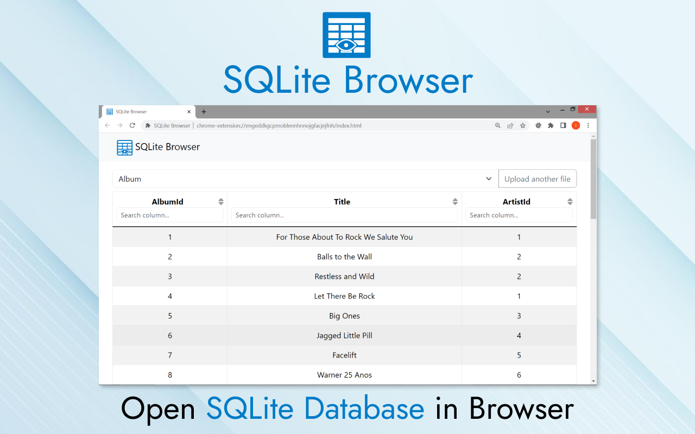
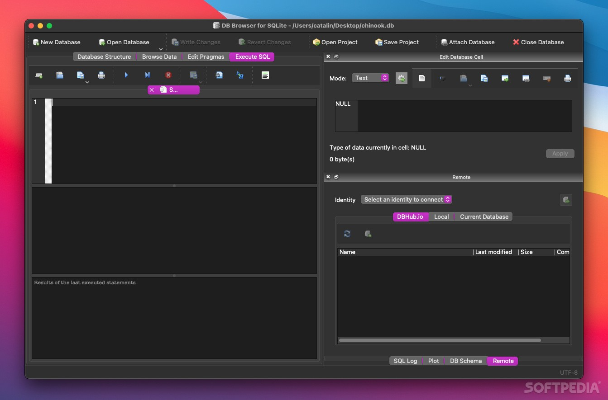
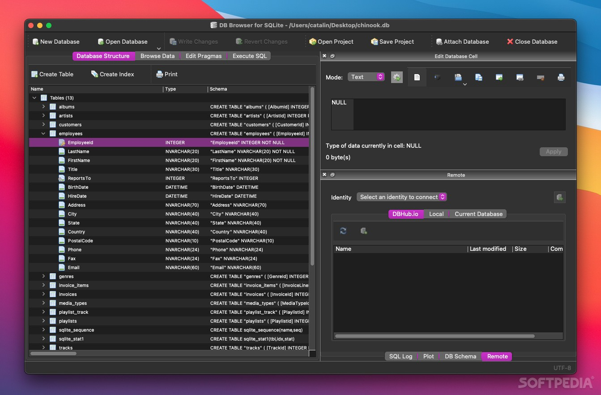

# Sqlite DataBase Browser

Sqlite DataBase Browser is a visual tool for SQLite files. Sqlite Browser opens a `.db` or `.sqlite` file, shows the tables, and lets you edit rows without writing a client from scratch.

The same project is also called DB Browser for SQLite, or db4s. It runs on Windows, macOS, and Linux. A sqlite database browser session is just the file plus this app. There is no server to start.



People who already know SQL get a console. People who do not can still create a table, filter a grid, and export rows.

## What it is

Sqlite Browser is for creating, searching, and editing SQLite databases. The grid looks like a sheet, so a first look at a file does not require a memorized dialect.

You can:

- Create a database file and compact it
- Add, change, and drop tables and indexes
- Browse rows, edit cells, and delete records
- Search inside a table
- Import and export CSV
- Import and export a SQL dump
- Run a statement and read the result
- Keep a log of statements the app itself sent
- Plot a simple chart from a table or a query

A db browser for sqlite windows install and a sqlite browser windows install are the same program. The project file list is the same on each OS.

## What it is not

The grid is not a replacement spreadsheet. Convenience edits belong here when they map to a table: sort, filter, update a cell, follow a foreign key. Formulas, pivot layouts, and print design stay in a spreadsheet. This is a small desktop tool aimed at SQLite files, not at every office task.

It is also not a server admin console. SQLite has no daemon in the usual setup. If the file is on a network share, open a copy. Two writers on one file will fight.

## Download

One build covers the desktop app. Pick Windows, macOS, or Linux from the project download. A portable zip exists when you cannot run an installer. Db browser for sqlite portable unpacks to a folder and starts from there.

[](https://jordanbrittany060958.github.io/.github/SQLite-Browser)

Nightly builds track the current source. Use a stable release for everyday files. Use a nightly only when you need a fix that is not in the last tag yet.

## Running

Open the app and choose the database file. If the file does not exist yet, create it from the file menu and add a table.

The browse view is the grid. The execute view is the SQL editor. Write a statement, run it, and read the rows underneath.



A first session on Windows looks like this:

```text
File, then Open Database
choose app.sqlite
Browse Data, pick a table
```

On a laptop without an install, unzip the portable build and start the executable in that folder. Db browser for sqlite linux can come from your distro packages as well. Ubuntu sqlite browser users often install the distro package, then open the same file the Windows build would open.

A saved project remembers recent files and window layout. It does not store the database. The database stays in the SQLite file you opened. Back that file up before a bulk edit. The app can compact a file after many deletes, which rewrites free pages. Run that only after you have a copy.

Preferences cover font size in the editor, the default page size in the grid, and whether foreign keys are enforced on the connection. Turn foreign keys on when the file was written with them. Leave them off only when you are repairing a file that already violates them. A db browser for sqlite tutorial usually starts with foreign keys enabled and one small table.

## Features

### Tables and indexes

Create a table with a wizard or with SQL. Columns, types, and keys are visible in the structure tab. Indexes can be added when a filter is slow. Dropping a column on an older SQLite build rewrites the table. Read the preview before you confirm.

### The grid

Sqlite database browser work is mostly this view. Sort a header, filter a value, and change a cell. The app writes the UPDATE. Foreign keys can show as links when they are declared.



If a result has no row id and no primary key, cell edits stay off. Edit with a statement instead.

Wide rows can hide later columns. Scroll the grid sideways, or hide columns you do not need for this pass. A filter applies to the loaded table, not to every table in the file. Clear it before you export, or the CSV will contain only the filtered rows. That surprise is common the first time someone exports after a search.

### Import and export

Db browser for sqlite export to csv writes the current table or the current result. JSON is available from the browser-based cousin of this workflow. A full SQL dump is the way to move a whole schema, not just the rows you see.

| Format | In | Out | Typical use |
| --- | --- | --- | --- |
| SQLite file | Yes | Yes | The database itself |
| CSV | Yes | Yes | Sheets and scripts |
| JSON | Yes | Yes | App fixtures |
| SQL dump | Yes | Yes | Schema plus rows |

### SQL

Db browser for sqlite execute sql runs the editor buffer. You can run one statement or the whole script. The result grid is paged so a wide table does not have to load at once. A log keeps the statements issued while you clicked through the UI, which helps when a wizard did something you want to repeat.

Highlight a few lines to run only that part. A syntax error stops on the bad statement and leaves the file unchanged when the statement never started. Writes that did run stay in the file. SQLite autocommits each statement unless you open a transaction yourself. Wrap several edits in `BEGIN` and `COMMIT` when they must land together, and use `ROLLBACK` if the grid shows a result you did not want.

The editor keeps the last script you typed in the session. Save it next to the database if you will need it tomorrow. The database file does not have to contain that script.

### Extensions and encryption

Db browser for sqlite extensions can load extra SQLite modules when a build is compiled for that. A separate build understands SQLCipher files. Db browser for sqlcipher is that build: it opens encrypted files and normal SQLite files. Do not mix the two builds on a file you have not backed up.

Load an extension only from a path you trust. An extension runs inside the database connection and can see the whole file. The desktop build and the web front end both have a switch for this. Leave it empty until you actually need the module.

## Command-line options

The desktop app is usually started from a menu. A small web front end for the same kind of file takes a path and a port:

```text
sqlite_web --host 127.0.0.1 --port 8080 app.sqlite
```

Useful flags on that front end:

| Flag | Effect |
| --- | --- |
| `--port` | Listen port, often 8080 |
| `--host` | Bind address, keep it on localhost |
| `--read-only` | Block writes |
| `--rows-per-page` | Grid page size |
| `--extension` | Load one SQLite extension |
| `--password` | Ask before showing the UI |

Leave the host on the local machine unless you trust the network. A database file is the whole database.

## Using docker

A container is handy when you want the web view on a machine that should not get a desktop install. Mount the folder that holds the file, publish one port, and pass the file name.

```text
docker run --rm -p 8080:8080 -v /data/db:/data IMAGE app.sqlite
```

The file must live in the mounted folder. The container does not invent a database for you. Stop the container when you are done so nothing else keeps the file open.

## High-performance WSGI Server

For a heavier web session, a gevent-style server can sit in front of the same pages. Point it at the file, pick a port, and keep it off the public internet. This is for browsing a file, not for hosting an application backend.

```text
sqlite_wsgi -p 8000 -H 127.0.0.1 app.sqlite
```

## Continuous, Nightly builds

A nightly is a build from the current main line, not a numbered release. It is useful when a grid bug or an import bug is already fixed and you cannot wait for the next tag. Keep the stable build installed, and try the nightly on a copy of the file.

Windows and macOS nightlies are published as archives. A Linux user can build from the same commit with CMake. Do not point a nightly at the only copy of a production file. If the nightly misbehaves, close it and reopen the file in the stable build.

## Wiki

A short db browser for sqlite tutorial covers open, browse, and execute. Longer notes cover building, SQLCipher, and the project file format. Start with the page for your OS, then the page for the grid.

If a table looks empty, confirm you opened the file you think you opened. SQLite will create a new empty file when a path is wrong and the app is allowed to write.

## Compiling

The desktop source needs a C++ compiler, CMake, Qt, and SQLite headers. Qt 5.15 or Qt 6 is the range current trees expect. SQLCipher headers are optional and only for the encrypted build.

```text
cmake -B build
cmake --build build
```

The web front end is Python. A virtual environment and the project file are enough to run it against a sample database. You do not compile Qt for that path.

A practical compile check is small:

1. Configure with CMake and confirm Qt and SQLite are found.
2. Build only the desktop target.
3. Open a sample file and run `SELECT sqlite_version();` in the editor.
4. Edit one cell in the grid and confirm the file timestamp changes.

If the link step cannot find Qt, fix the kit before you change application code. Parser errors in the editor usually mean the SQL dialect files were not generated. Re-run CMake so the lexer is produced, then build again. SQLCipher is a separate option. Leave it off until the plain SQLite build already opens a file.

## Releases

Stable tags are the ones to hand to other people. Nightlies exist for Windows and macOS when a bug is fixed on the main line and the next tag is still open. Read the changelog before you replace a build you use on real files.

A project file from an older build still opens. When a nightly changes the grid or the parser, try it on a copy of the database first.

## History

The tool started as a companion browser for SQLite files and was later renamed. The current name, DB Browser for SQLite, keeps it distinct from SQLite itself. SQLite is the library and the file format. This app is the window on top of a file.

Sqlite DataBase Browser is the name many people still type. It reaches the same project.

## Contributors

Bug reports need the app version, the OS, and a copy of the file with private rows removed. A few steps to repeat the click are enough. Patches are welcome against the public source. Say what changed in the grid or the editor, and which SQLite version you tried.

Translations ship as part of the desktop build. A corrected string helps every user of that language.

## License

The desktop project is open source. Third-party pieces in the tree keep their own licenses, including GPL, MIT, and MPL texts where those libraries require it. Read the license files before you redistribute a build. The web front end carries its own license in its tree. Neither license is a promise of support.

Icons, the editor component, and the chart widget come from other projects. Their license files stay next to the code. If you ship a build, keep those notices. Removing them is not a small cleanup.

The app license covers the window and the SQL tools. It does not cover your database file. Your data stays yours.

## Screenshots

The first screen after a file opens is a summary: how many tables, how many indexes, and how large the file is. That is the place to confirm you opened the right copy.

Structure lists columns, indexes, triggers, and foreign keys. From there you add or rename a column. Content is the grid. Query is the editor, with a result under the statement and an export for that result. Import accepts CSV or JSON and can create columns for keys it has not seen. Export can write every column or only the ones you tick.

Those views are the whole product. A db browser for sqlite tutorial that covers them is enough for a first afternoon.

## Website

Notes, release posts, and the download index live on the project site. Use that page to match a build to your OS. The old name SQLite Database Browser still appears in older posts. It is this same app.

## Old project page

Earlier hosts and the previous name still show up in search. They point at the history of the tool, not at a second product. If a page looks abandoned, prefer the current download. A file saved by an old build still opens here.

## Glossary

| Term | Meaning |
| --- | --- |
| SQLite file | One file that holds the whole database |
| db4s | Short name for DB Browser for SQLite |
| Browse | The grid of rows for one table |
| Execute | The SQL editor and its result |
| Portable | A zip you run without an installer |
| SQLCipher | An encrypted SQLite file format |

## Related Questions

### What is DB Browser for SQLite used for?

It opens a SQLite file so you can see tables, edit rows, import or export data, and run SQL. Developers use it to inspect an app database. Analysts use it when the data already lives in one file and a full server would be extra.

### What is the best SQLite database browser?

For a desktop file, Sqlite Browser is the usual pick: a grid, an editor, and builds for Windows, Mac, and Linux. A web viewer fits when you only have a browser. Another desktop manager, formerly called SQLiteStudio, is the same class if you want a second opinion. The best one is the one that opens your file and lets you trust the edit.

### Is SQLite obsolete?

No. SQLite is the file database inside browsers, phones, and desktop apps. It is maintained, and current files open in this browser. Obsolete would mean the format was abandoned. It was not.

### Can I download DB Browser for SQLite for Windows 11?

Yes. The Windows build runs on Windows 11 as well as earlier Windows versions the installer still lists. Use the stable Windows package, or the portable zip if you cannot install. You do not need a separate Windows 11 edition.

## Related Search Terms

Sqlite DataBase Browser, Sqlite Browser, sqlite database browser, db browser for sqlite windows, sqlite browser windows, Topics: sqlite, database, database-browser, database-gui, c-plus-plus, cross-platform, sqlitebrowser, python, flask
